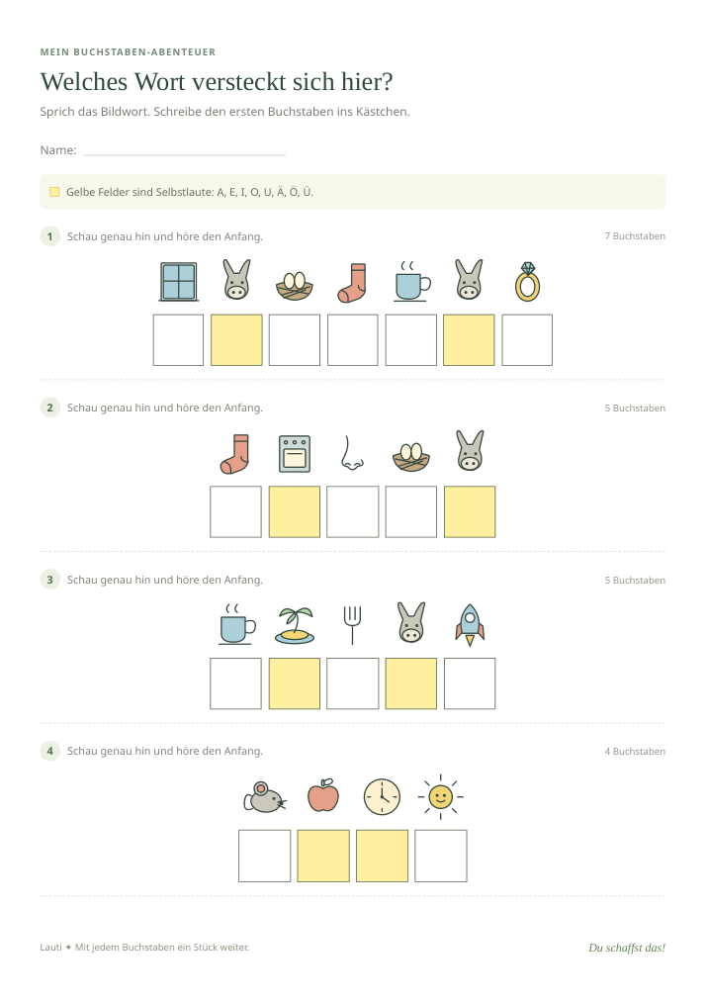

# Lauti

Ein kleiner Lernblatt-Generator für Anlaut-Bilderrätsel. Ein bis vier Wörter eingeben, Bilder prüfen und auf A4 drucken oder über den Druckdialog als PDF speichern. Vokalfelder (auch Ä, Ö, Ü) sind gelb. Alle Illustrationen sind eigene SVG-Zeichnungen und werden mitgeliefert; kein Login, keine externen Schriftarten, kein Tracking und keine API nötig. Eingaben bleiben im Browser und werden nicht gespeichert.

## Beispiel und Vorschau

[Beispiel-Lernblatt als PDF](docs/beispiel-lernblatt.pdf) · [Web-App-Vorschau](docs/webapp-vorschau.png)

Das Beispiel enthält die vier Rätselwörter **Fenster, Sonne, Tiger und Maus**. Die Schreibfelder sind leer, die Vokale gelb markiert. Es wurde mit Chromium als einseitiges A4-PDF erzeugt.



## In Home Assistant verwenden

Für **Home Assistant OS** ist kein eigener Container oder Add-on nötig: Home Assistant kann die statischen Dateien selbst ausliefern.

1. Im HA-Konfigurationsverzeichnis den Ordner `www/lauti` anlegen (z. B. über Studio Code Server, File editor oder die vorhandene Netzwerkfreigabe).
2. `index.html`, `style.css` und den vollständigen Ordner `src` aus diesem Repository hineinkopieren. Ergebnis:

   ```text
   /config/www/lauti/index.html
   /config/www/lauti/style.css
   /config/www/lauti/src/app.js
   /config/www/lauti/src/art.js
   /config/www/lauti/src/puzzles.js
   ```

3. Falls `www` gerade erst angelegt wurde, Home Assistant einmal neu starten.
4. Über die eigene HA-Adresse mit dem Pfad `/local/lauti/index.html` öffnen.
5. Optional auf dem Dashboard eine Schaltfläche einrichten:

   ```yaml
   type: button
   name: Lernblatt erstellen
   icon: mdi:alphabetical-variant
   tap_action:
     action: url
     url_path: /local/lauti/index.html
   ```

Die separate Seite ist auf Handy und Tablet und für den Druckdialog am praktischsten. Die App braucht keine HA-Zugangsdaten. Dateien unter `/local/` werden von HA ohne Anmeldung ausgeliefert: dort keine vertraulichen Dateien ablegen. Bei Updates dieselben App-Dateien ersetzen und die Seite neu laden. Für die Installation werden nur `index.html`, `style.css` und `src/` benötigt; Dokumentation, Tests und Beispieldateien müssen nicht nach Home Assistant kopiert werden.

Die Anleitung ist vorbereitet; eine Installation in deiner HA-Instanz wurde hier nicht ausgeführt oder geprüft.

## Lokal entwickeln / auf einem separaten Pi betreiben

Voraussetzung: Python 3. Im Repository:

```sh
python3 -m http.server 8080 --bind 0.0.0.0
```

Dann die IP des Rechners mit Port 8080 im Browser öffnen. Der Python-Server dient der Entwicklung; für dauerhaften separaten Betrieb die Dateien mit einem vorhandenen Webserver wie nginx ausliefern. Kein Build und keine Paketinstallation erforderlich. ES-Module benötigen HTTP; `index.html` nicht einfach als lokale Datei öffnen.

## Bedienung und Druck

- Ein Wort pro Zeile, alternativ durch Komma oder Semikolon trennen. Maximal vier Wörter, je zwölf Buchstaben.
- Mit „Lernblatt erstellen“ neue Rätsel erzeugen. Das gilt auch für geänderte Eingaben.
- Ein Bild anklicken, um zur nächsten verfügbaren Alternative zu wechseln. „Bilder neu mischen“ wechselt alle verfügbaren Alternativen; Motive mit nur einer Variante bleiben bestehen.
- Bildnamen dienen nur der Prüfung am Bildschirm und erscheinen nicht im Druck.
- Lösungen optional einblenden. Standard: erster Buchstabe groß, die folgenden klein; alternativ nur Großbuchstaben. Beide Einstellungen beziehen sich auf die Lösung, die Schreibfelder sind ansonsten leer.
- „Drucken / PDF“ öffnet den Browser-Druckdialog. A4, Hochformat, 100 % Skalierung, keine Browser-Kopf-/Fußzeilen und **Hintergrundgrafiken aktivieren**, damit die gelben Vokalfelder erscheinen. Am iPhone über die Druckvorschau als PDF teilen/sichern.
- Alle Rätsel stehen auf einer Seite. Lange Wörter haben kleinere Schreibfelder; für Schreibanfänger eher kurze Wörter verwenden.
- Kein automatischer Druckerzugriff: Der Browser beziehungsweise das Betriebssystem übernimmt die Druckerauswahl.

## Pädagogische Grenzen und Bildauswahl

Die Wörter sind frei wählbar, die Motive bewusst kuratiert. Bilder können unterschiedlich benannt werden (z. B. Tasse/Becher): Bildwörter vorher gemeinsam besprechen und bei Bedarf wechseln. `Vogel` beginnt geschrieben mit V, gesprochen aber mit /f/; Xylophon, Yak, Clown und Qualle sind ebenfalls schwierigere Anlaute. Die App zeigt Schreibbuchstaben, keine vollständige phonetische Anlauttabelle. Für den Einstieg einfache, lautnahe Wörter bevorzugen.

Ä, Ö und Ü sind enthalten, ß hat kein eigenes Anlautbild und wird mit verständlichem Hinweis abgelehnt. Ebenso Leerzeichen innerhalb eines Wortes, Bindestriche, Ziffern und andere Sonderzeichen. Sch/Ch sind einzelne Buchstabenfelder, keine Lautgruppen. Die Kennzeichnung gibt beim Rätseln bereits einen Hinweis auf die Selbstlaute.

Neue geprüfte Bildwörter in `src/puzzles.js` unter dem passenden Anfangsbuchstaben ergänzen; die zugehörige SVG-Zeichnung liegt in `src/art.js`. Keine Bildrechte Dritter nötig, alle Zeichnungen wurden für diese App erstellt.

## Tests

Node.js 22 oder neuer, keine npm-Abhängigkeiten:

```sh
npm test
```

Die Tests prüfen Anlaut-Zuordnung, Bildalternativen, SVG-Abdeckung, Umlaute, Vokale und Eingabegrenzen. Browser- und Drucktests wurden zusätzlich mit Chromium ausgeführt; reale Drucker, Safari und eine laufende HA-Installation sind damit nicht abgedeckt.

Die Browserprüfung lässt sich bei laufendem Server mit Python, Playwright, installiertem Chromium (`/usr/bin/chromium`) und optional PyMuPDF wiederholen:

```sh
python3 tests/browser.py
```

`LAUTI_TEST_URL` setzt eine andere App-Adresse, `LAUTI_ARTIFACTS` das Ausgabeverzeichnis (Standard: `/tmp/lauti-artifacts`). Mit PyMuPDF wird zusätzlich geprüft, dass beide Druckproben genau eine Seite mit Abschlusszeile enthalten.
